# 胖哥每日壁纸 · 全要素界面设计与本机验收报告

2026-11-28 · 1.1.9.2611B · 正式程序实际截图

## 交付范围与结论

版本 1.1.9.2611B，PE 数值版本 1.1.9.2611。本轮直接改造正式 C++17 / Win32 / Direct2D 界面：主窗采用今日壁纸、设置、关于三个标签；壁纸浏览、原图导出和主题导出集中到独立的壁纸库工作台。旧版花形软件图标用于 EXE 资源、窗口类、托盘与关于页。截图均来自本机实际编译程序，非概念图。本机回归已通过；Win7 实机、跨 DPI/多显示器矩阵和低配置机器的性能验收留后续。

## 业务边界

ProductBackend.cpp、TaskRunner.cpp、Library.cpp 未改动；Network.cpp 与 Platform.cpp 仅为导出声明增加静态链接宏保护。本轮调整页面布局、控件表现、界面偏好和预览加载。图库格式、网络来源、桌面应用、轮播、原图保存与主题打包继续调用现有后端。七日壁纸与主题手动选图继续处于原先未开放范围；开机自启继续只保存已有界面偏好，不新增系统自启写入。

## 01 · 今日壁纸 / 浅色

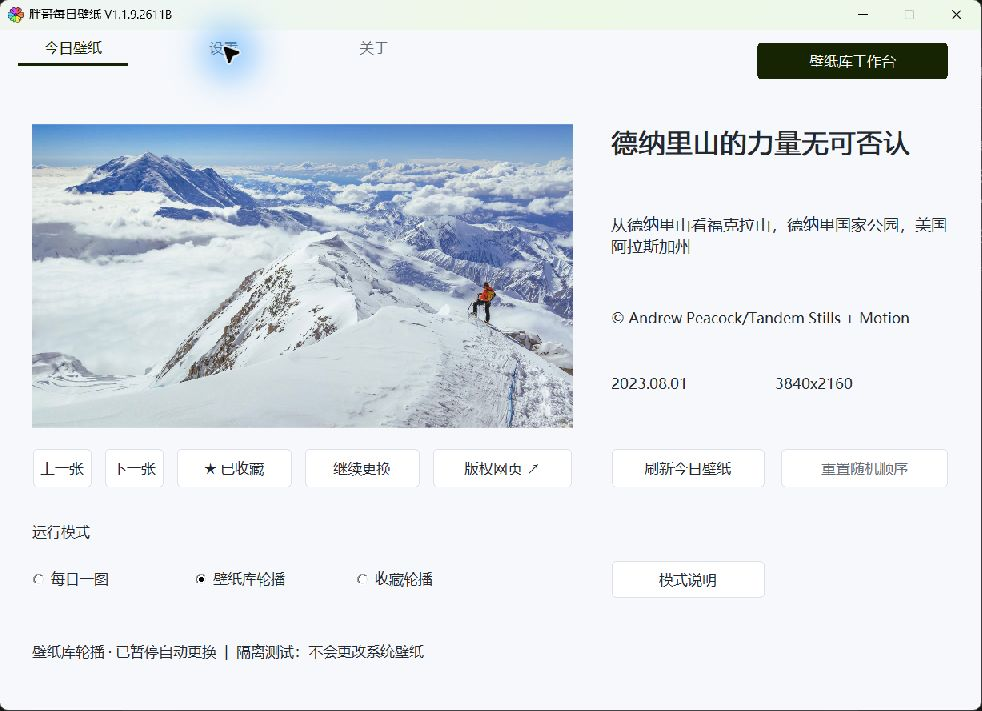

980×680 逻辑尺寸。左侧预览，右侧 title、description、© 作者，下方日期与所选桌面尺寸。首页显示当前壁纸，故不添加设为壁纸按钮。

## 02 · 设置 / 浅色

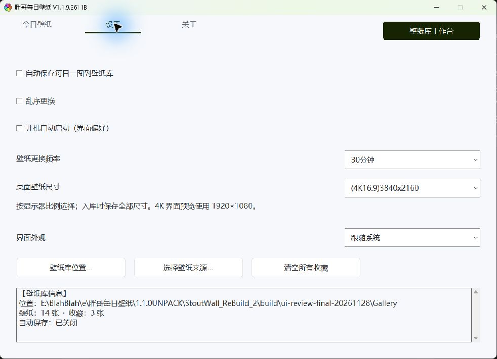

列表式设置可继续增加项目：自动入库、乱序、自启偏好、频率、桌面尺寸、界面外观，以及图库位置、来源、清空收藏和图库信息。

## 03 · 外观选项

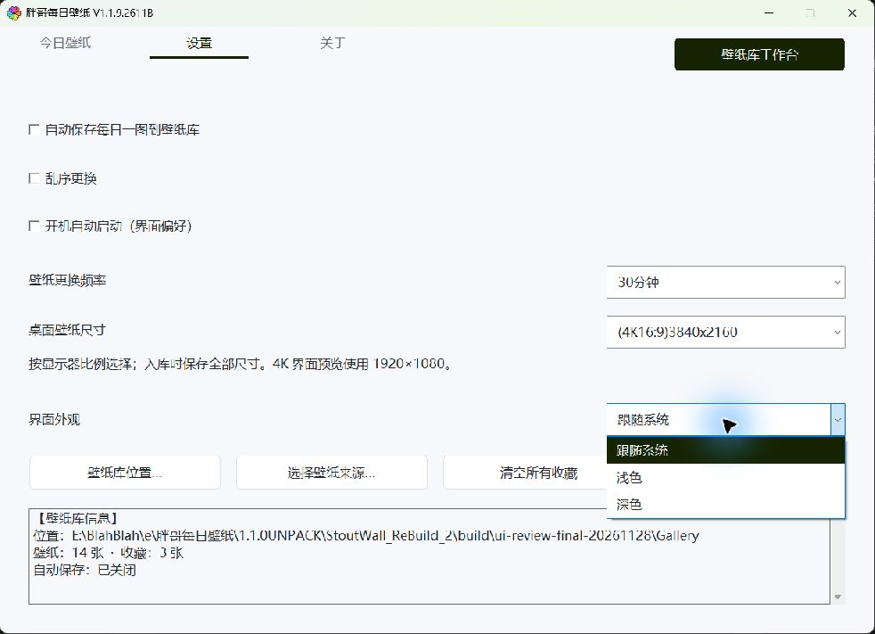

本机显示跟随系统、浅色、深色。无系统应用明暗能力的旧系统只提供浅色与深色。

## 04 · 设置 / 深色

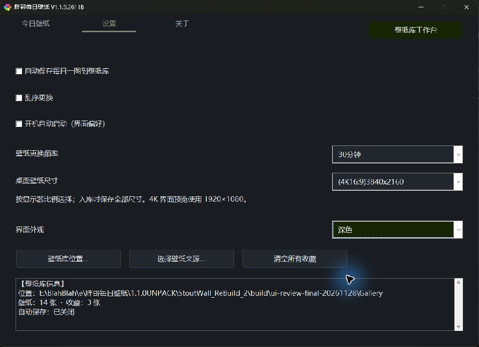

界面模式通过独立的 Interface.ini 保存。原生滚动条、下拉箭头、系统消息框及文件对话框保留宿主系统外观，尚未全部自绘为深色。

## 05 · 今日壁纸 / 深色

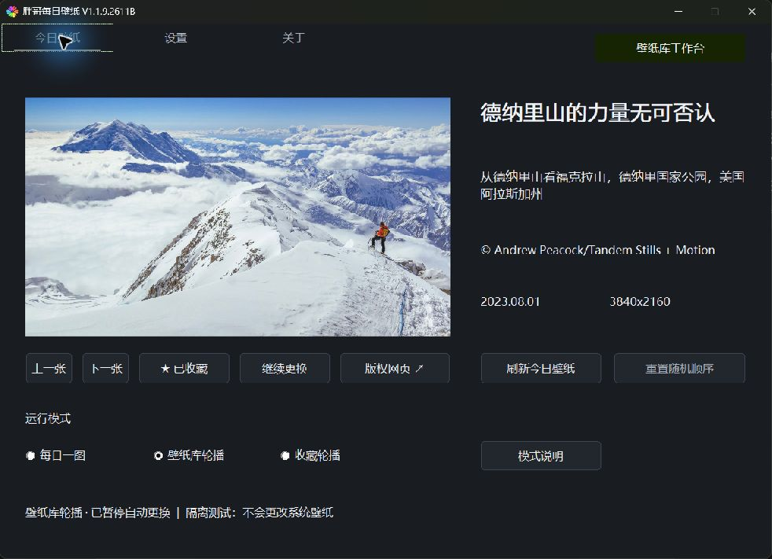

首页保留上一张、下一张、收藏、暂停/继续、版权网页、刷新、随机重排、三个运行模式与模式说明。状态栏明确显示隔离测试状态。

## 06 · 关于 / 深色

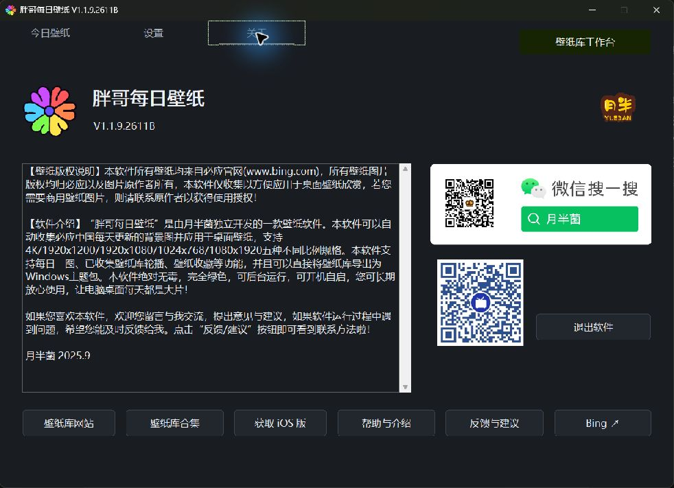

旧软件图标、版本、说明、作者标识与二维码、网站和帮助入口、反馈与退出完整保留。旧版说明文本按本轮 UI-only 原则保留。

## 07 · 壁纸库工作台

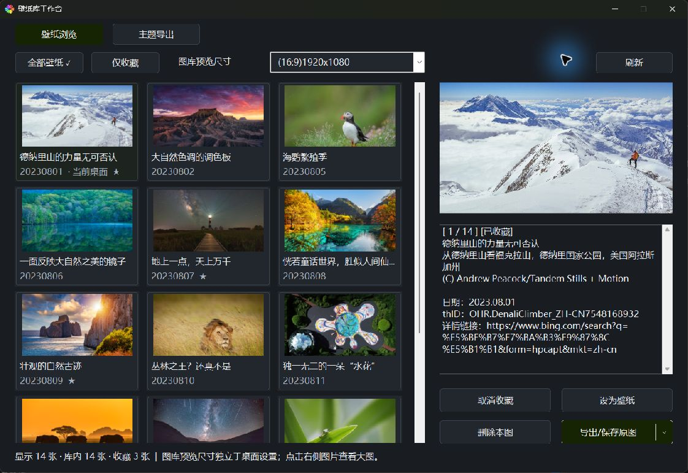

1120×740 逻辑尺寸。左侧图卡，右侧预览、详情和操作；已入库的当前壁纸直接标记当前桌面，无当前使用标签页，无来源字段。

## 08 · 原图导出组合按钮

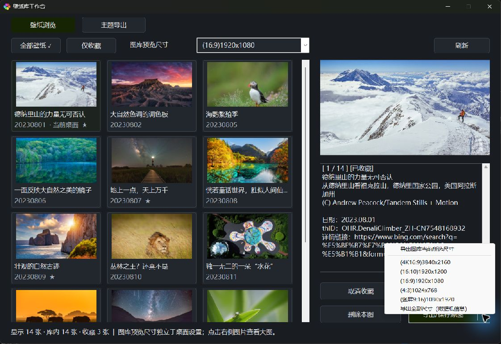

使用原生 BS_SPLITBUTTON。主按钮导出图库当前所选尺寸，下拉可选择 UHD、1920×1200、1920×1080、1024×768、1080×1920 或全部尺寸（附壁纸信息）。

## 09 · 仅收藏筛选

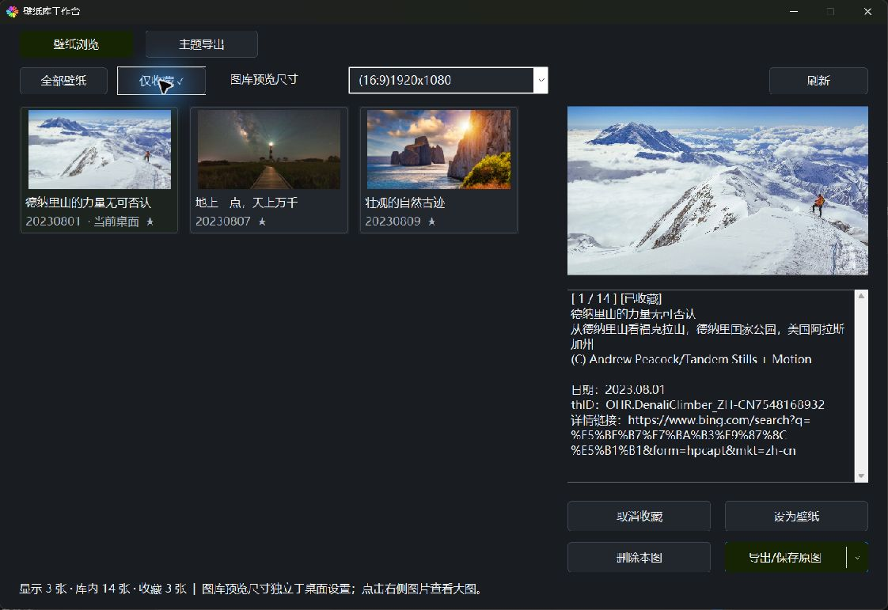

仅影响工作台显示的本地筛选；不改变壁纸轮播模式。底部同时报告显示数量、库内总数与收藏数。

## 10 · 选中壁纸详情

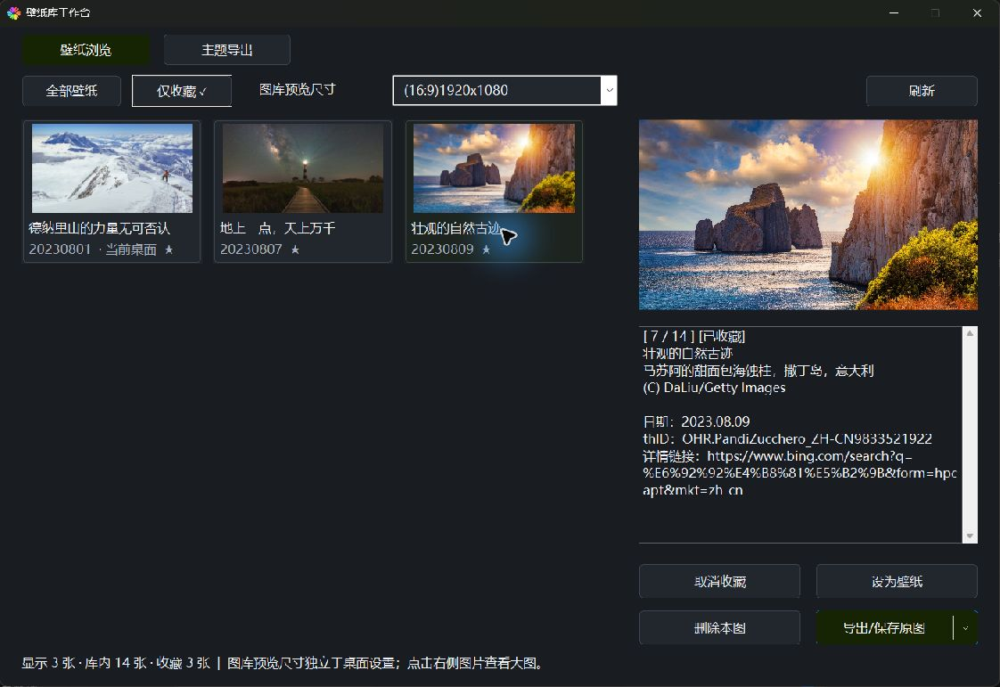

标题、描述、作者、日期、thID、详情链接、原库序号和收藏状态沿用旧版对外字段。长信息使用可滚动文本区。

## 11 · iOS 页面

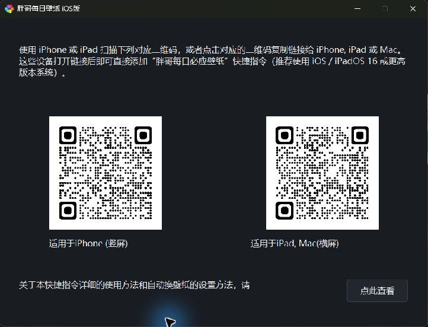

iPhone 竖屏、iPad/Mac 横屏双二维码，原说明、复制和查看介绍入口保留。

## 12 · 壁纸来源

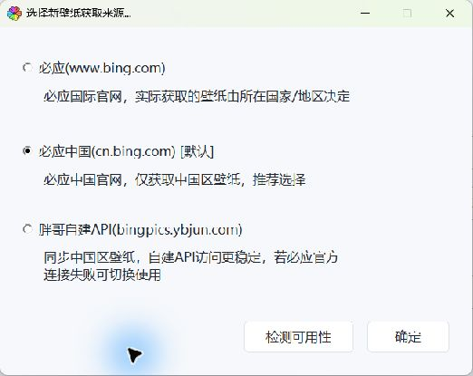

三来源、说明、检测可用性和确定入口保留；最终版已扩大说明区域，全文可见。来源是全局设置入口，不是图库项目字段。

## 13 · 图库位置 / 迁移

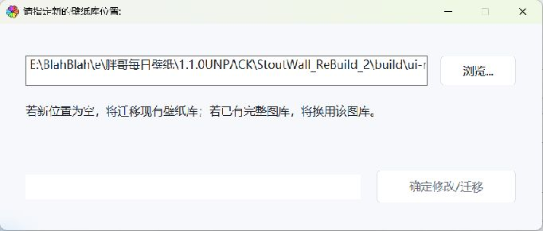

路径输入与浏览、迁移说明、进度和确认操作保留。长路径在单行编辑框内水平滚动，不强行截断存储内容。

## 14 · 主题导出 / 现代格式

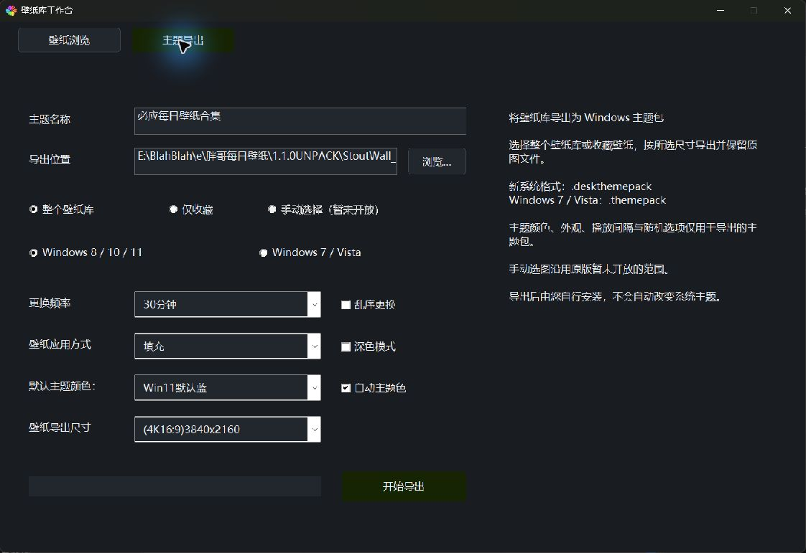

主题页嵌入工作台。名称、目录、全库/收藏、格式、间隔、乱序、应用方式、深色、主题色、自动主题色、尺寸、进度、导出均覆盖。

## 15 · 主题导出 / 兼容格式

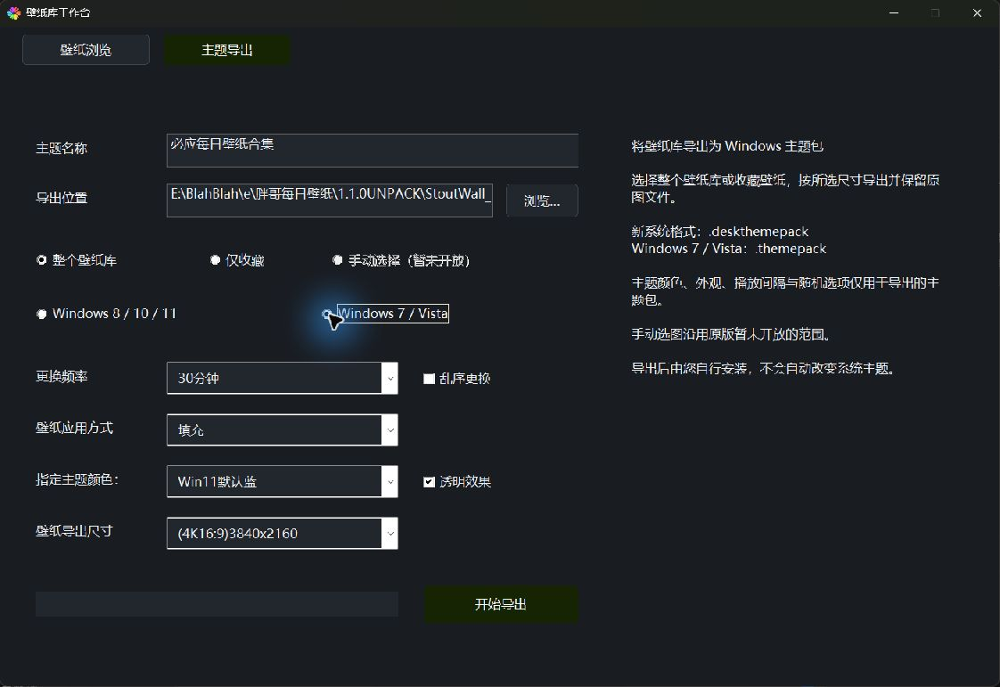

选择 Windows 7 / Vista 后显示对应主题色与透明选项；这表示生成兼容格式，不表示已在 Win7 运行验收。手动选图仍明确标为暂未开放。

## 16 · 大图查看器

首页和工作台预览均保留大图入口。UHD 在界面使用 1080p 数据；保存、桌面应用和主题导出保持原尺寸。

## 17 · 大图右键菜单

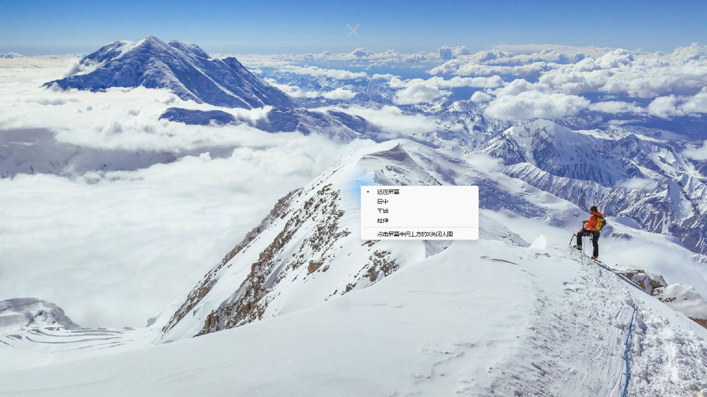

适应屏幕、居中、平铺、拉伸与顶部关闭入口保留；这组菜单仅影响查看器表现。

## 全要素功能对照 · 主窗

| 区域 | 界面要素 | 既有行为 / 核验 |
| --- | --- | --- |
| 全局 | 旧花形图标、版本、Windows 强调色、三种明暗模式 | EXE 图标输入与旧资源 SHA-256 一致；窗口和关于页实测；深浅切换与重开持久化实测 |
| 导航 | 今日壁纸、设置、关于；常驻壁纸库工作台入口 | 三标签原生结构与几何自动检查；本机逐页打开 |
| 首页信息 | title / description / © author / 日期 / 桌面尺寸 | 绑定原记录字段；无首页设为壁纸按钮 |
| 首页操作 | 上一张、下一张、收藏、暂停/继续 | 原 ProductAction 调用；后端回归覆盖 |
| 首页操作 | 版权网页、刷新今日壁纸、重置随机顺序 | 旧事件路由保留；网络和随机序列由后端回归覆盖 |
| 首页模式 | 每日一图、壁纸库轮播、收藏轮播、模式说明 | 原模式与启用条件保留；不新增七日模式 |
| 设置 | 自动保存、乱序、开机自启界面偏好、频率 | 原配置写入与重开回归；测试不写真实自启项 |
| 设置 | 桌面尺寸（五档） | 仍是桌面后端设置；不与工作台预览尺寸共用变量 |
| 设置 | 外观、图库位置、来源、清空收藏、图库信息 | 外观为新界面偏好；其余调用原功能；最终辅助窗口截图核验 |
| 关于 | 软件图标、名称、版本、说明、作者图与双二维码 | 本机打开并核验可见性；沿用旧资源 |
| 关于 | 壁纸库网站、合集、iOS、帮助、反馈、Bing、作者链接、退出 | 入口与事件保留；iOS 页面及正常退出实测；未宣称外部站点可用性已验证 |
| 托盘 | 图标、壁纸信息、上一/下一、暂停、收藏、保存、重载、模式、显示、退出 | 保留同一 ShowTrayMenu 路由；七日相关项继续禁用；本轮未从系统托盘逐项点击 |

## 全要素功能对照 · 工作台与辅助页面

| 区域 | 界面要素 | 既有行为 / 核验 |
| --- | --- | --- |
| 壁纸浏览 | 全部 / 收藏、图卡、当前标记、图库独立尺寸、刷新 | 本机核验全库/收藏切换与选择；尺寸状态在代码中独立保存，五档控件存在 |
| 详情 | 库序号、收藏、title、description、author、日期、thID、link | 沿用旧 GalleryDetails 输出，无新增来源字段 |
| 图片操作 | 收藏/取消、设为壁纸、删除 | 仅工作台提供设为壁纸；均路由到原后端；后端集成覆盖 |
| 原图导出 | 组合主按钮 + 五尺寸 + 全尺寸及信息 | 原生 split button 自动检查；实际菜单截图；原图字节/尺寸与导出回归 |
| 主题导出 | 全库/收藏；现代 / 兼容格式；名称、目录、频率、乱序 | 两个单选组相互独立；本机切换检查；主题专项回归 |
| 主题参数 | 填充等应用方式、深色/透明、颜色/自动颜色、五尺寸、进度与开始 | 沿用原格式对应参数；两格式 × 五尺寸自动验证 |
| 来源 | 国际、中国、自建 API；检测与确定 | 只做界面布局；保留既有网络链路 |
| 图库位置 | 输入、浏览、说明、进度、修改/迁移 | 冲突、锁定回滚与重试由后端回归覆盖；本机核验布局 |
| iOS | 双二维码、设备说明、复制与介绍 | 旧二维码和入口保留；本机核验布局 |
| 大图 | 四种显示模式、关闭 | 实际打开与右键菜单截图；重绘基准测试 |
| 未开放 | 七日壁纸、主题手动选择 | 维持既定边界，不补造后端功能 |

## 明暗与强调色规则

外观状态保存到独立 Interface.ini，不混入后端桌面配置。应用读取系统应用明暗键并检测系统版本能力：工作站 build ≥17763 且存在能力键才开放跟随系统；服务器采用 build ≥26100 且有能力键的保守门槛。Win7、Win8.x 和早期 Win10 等不开放跟随系统。此门槛是本项目的降级策略，不代表已经完成所有系统版本实测。强调色通过动态加载 DwmGetColorizationColor 获取，移除 alpha 后用 RGB(r,g,b) 构造纯 RGB；读取失败则用系统高亮色。文字与选中导航按背景调整可读性；标题栏深色调用失败可降级。系统主题、设置和 DWM 颜色变化会触发刷新。

## 尺寸隔离与预览加载

桌面尺寸继续使用原 config.currentWall.size；工作台使用 GalleryWorkbench.previewSize，单独写入 Interface.ini 的 Gallery/PreviewSize。五档是既有分辨率的独立选择，不是新增任意像素输入。工作台尺寸变化只重建其预览与缩略图，不调用桌面尺寸变更。当任一界面选择 UHD 时，显示数据使用 1920×1080；图像按比例适配，避免拉伸。缩略图只读取可见项目，每批最多 6 张，渲染缓存最多 64 张；空图也缓存，避免反复重试。D2D 目标丢失时清理对应位图缓存。原图保存和主题导出不降采样。

## 解耦与链接边界

| 构建单元 | 职责与交付形态 |
| --- | --- |
| ProductLayout | 主窗和辅助窗口的布局映射；界面库中的独立源文件 |
| GalleryWorkbench | 工作台布局、图卡展示状态和本地筛选；不持有网络/数据库业务 |
| ReplicaUi / Assets | Win32 原生控件、绘制、主题和资源加载；stoutwall-ui.lib |
| ProductUi | 页面事件到后端请求的协调，保留单一后端工作线程所有权 |
| ProductBackend / TaskRunner | 业务和工作线程；stoutwall-backend.lib；本轮未改动 |
| Network / Platform / Library | 分别生成静态 .lib 后链接；/MT、/OPT:REF、/OPT:ICF |
| gallery.dll | 旧易语言图库格式兼容适配层；本轮保留，后续独立迁移任务才能消除 |
| assets.dll | 仅资源，保留实际使用的九项旧图标/二维码/图片资源，不是代码模块 |
| 7za.exe / cabarc.exe / EDT | 既有压缩与主题运行依赖、基础图库；不塞进主 EXE |

## 静态编译的实际结果

自研 C++ 模块与 CRT 已静态链接，PE 审计无 MSVCRT/MSVCP/VCRUNTIME/UCRT 动态导入，且无旧 network/platform/library DLL 导入或残留。这不等于零 DLL 分发：gallery.dll 和纯资源 assets.dll 仍随包提供，也仍调用 Windows 系统 DLL。保留图库兼容层是为了遵守本轮不改变数据业务的边界。

## 交付运行文件体积

| 文件 | 字节数 | MiB | 说明 |
| --- | --- | --- | --- |
| StoutWall.exe | 1118208 | 1.066 | 主程序 |
| assets.dll | 4818432 | 4.595 | 资源 / 兼容 / 工具 / 许可 |
| gallery.dll | 815104 | 0.777 | 资源 / 兼容 / 工具 / 许可 |
| 7za.exe | 949248 | 0.905 | 资源 / 兼容 / 工具 / 许可 |
| cabarc.exe | 114688 | 0.109 | 资源 / 兼容 / 工具 / 许可 |
| ForTheme.EDT | 18880 | 0.018 | 资源 / 兼容 / 工具 / 许可 |
| GalleryBase.EDT | 62590577 | 59.691 | 基础图库数据 |
| 7zip-copying.txt | 27032 | 0.026 | 资源 / 兼容 / 工具 / 许可 |
| 7zip-License.txt | 6341 | 0.006 | 资源 / 兼容 / 工具 / 许可 |
| 7zip-unRarLicense.txt | 1961 | 0.002 | 资源 / 兼容 / 工具 / 许可 |

## 包体说明

运行白名单文件合计 70,460,471 字节（67.20 MiB），未计报告与验收记录。其中 GalleryBase.EDT 是单独的约 59.69 MiB 基础图库数据，不是主 EXE 的代码体积。交付目录不包含 obj、lib、exp、基准测试 EXE 或重复解压的图库。

## 本机验证与证据

| 检查 | 结果与范围 | 项目内证据路径 |
| --- | --- | --- |
| 最终产品构建 | 成功，无编译警告；x86、/MT | build/ui-final/build.log |
| 最终 UI / 预览回归 | PASS：边界、唯一控件名、三标签、split button、主题内嵌、网格、深浅主题、空图缓存 | build/ui-final/preview-test.log |
| 原图保真 | PASS：大于 4 MiB 的图库图片完整读取；保存/导出原尺寸不变 | build/ui-final/preview-test.log |
| 后端集成 | PASS：图库重开、收藏、轮播/暂停、空/单图库、导出删除、迁移冲突回滚，以及网络超时取消和安全退出 | build/ui-validation/backend_integration_test.log |
| 主题专项 | PASS：2 格式 × 5 尺寸、图片字节/参数、同名保护、全库 UHD、单收藏、Unicode、坏模板重试和错误输入 | build/ui-validation/theme_integration_test.log |
| PE 审计 | PASS：5 个 PE 全 x86，子系统 ≤6.01，无动态 CRT / 旧自研 DLL | build/ui-final/pe-audit.json |
| 交付目录启动 | 从最终交付目录运行，独立目录首次释放 14 张壁纸；版权网页事件写入隔离日志 | build/ui-final/delivery-smoke.json |
| Computer Use | 本机最终版逐页截图：主窗、工作台、收藏、导出菜单、两种主题格式、iOS、来源、位置、大图与退出 | docs/ui-review-20261128/images/ |
| 实际主题导出 | 本轮前一 UI 修订已从工作台导出 UHD 收藏 deskthemepack；未安装主题；同一后端另有主题专项覆盖 | build/ui-review-20261128/必应每日壁纸合集.deskthemepack |
| 旧 GUI 自动化 | 本轮未执行；旧五标签脚本不适用于新三标签布局，不列为通过证据 | tools/verify_product.ps1（历史脚本） |
| Win7 与低配 | 本轮未做实机验收；PE 检查和兼容主题导出不能替代实机运行 | 留后续 |

## 最终单次预览基准 · 本机隔离运行

| 项目 | P50 / 测量值（ms） | P95（ms） |
| --- | --- | --- |
| 初始化 | 190.326 | — |
| 首次图库模式 | 881.156 | — |
| 未缓存选图 UHD（n=8） | 51.373 | 54.623 |
| 已缓存选图 UHD（n=25） | 1.713 | 1.822 |
| 已缓存图库模式 UHD（n=15） | 18.762 | 45.719 |
| 原始 UHD 查看器解码（n=15） | 63.935 | 67.775 |
| 1080p 显示源解码（n=15） | 13.952 | 15.338 |
| 查看器首次绘制 | 407.691 | — |
| 查看器模式重绘（n=40） | 10.863 | 12.050 |

## 性能数据解释

最终基准确认显示解码为 1920×1080，CPU 像素缓冲为 8,294,400 字节。以上是同一台机器、隔离夹具的一次结果，不代表线上网络耗时或所有设备表现，也没有与原易语言版进行公平并行对照。首帧、冷启动、图库初次释放和低配机器仍应分开评价。

## 后续审阅与测试点

| 事项 | 当前状态 |
| --- | --- |
| 视觉细节 | 基础全局样式已应用；后续可继续审阅密度、图卡比例、信息行高和主题色可读性 |
| 系统原生区域 | 滚动条、下拉箭头、弹出菜单和系统消息框部分仍沿用系统样式；不是所有控件完全自绘 |
| 自定义尺寸的含义 | 当前实现为五种现有分辨率在工作台中独立选择；若需要任意像素或图卡物理大小输入，应另定交互规则 |
| 环境矩阵 | 待 Win7/8.x/早期 Win10、服务器、多显示器、DPI 切换、小屏幕与低配机器验证 |
| 纯静态交付 | 仍需单独迁移旧图库 ABI/格式兼容层，才能进一步去掉 gallery.dll；本轮不改此业务层 |
| 未开放业务 | 七日壁纸、主题手动选图继续禁用；开机自启仍为既有界面偏好 |

## 手动查看方法

打开 build/deliverables/StoutWall-1.1.9.2611B-UI-20261128，双击“新版界面预览.cmd”。它以 --ui-test 和包内 review-data 独立目录运行，不更改真实桌面、自启项或旧软件数据；外部网页/复制操作仅记到测试日志。首次会从 GalleryBase.EDT 释放基础图库。直接运行 StoutWall.exe 则使用正常产品数据目录并按设置操作桌面。报告可打开本目录 index.html；交付包还附带报告副本、验收日志与 SHA256SUMS.txt。此次未做 Git 提交、推送或 GitHub 发布。
